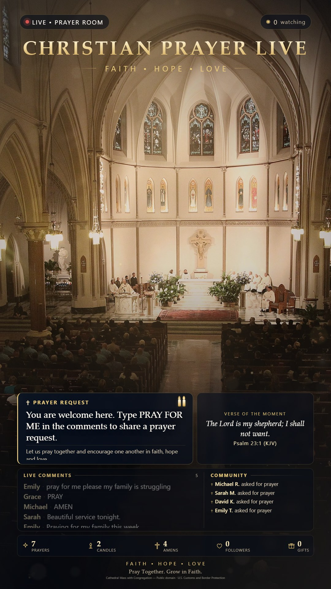
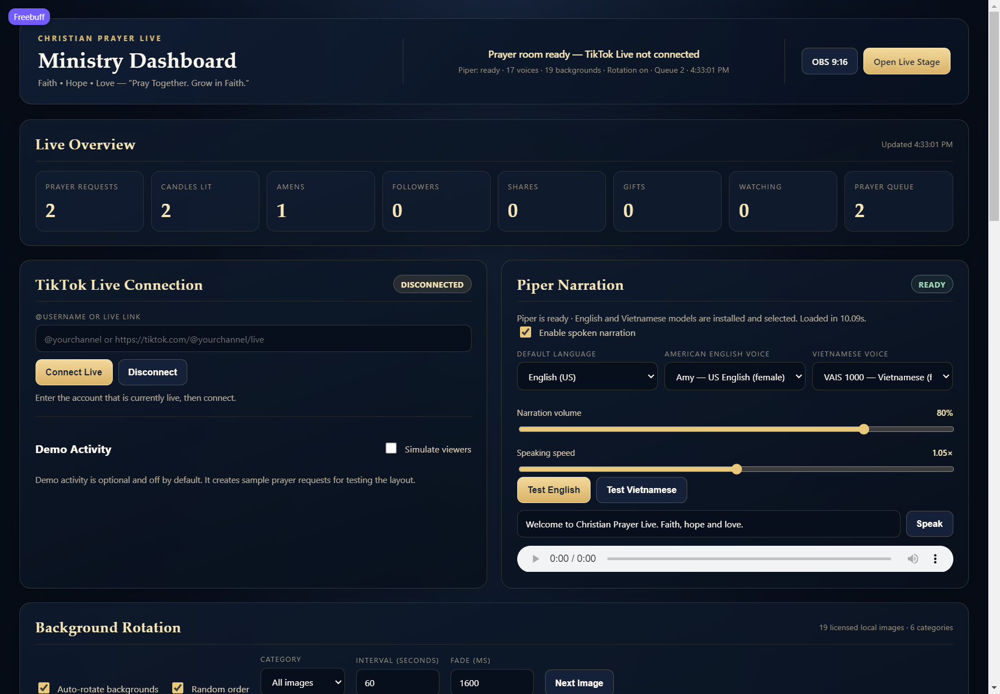
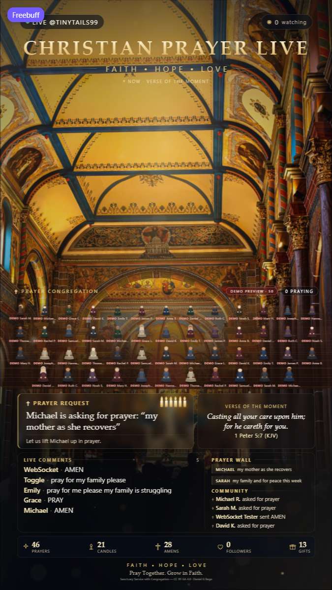
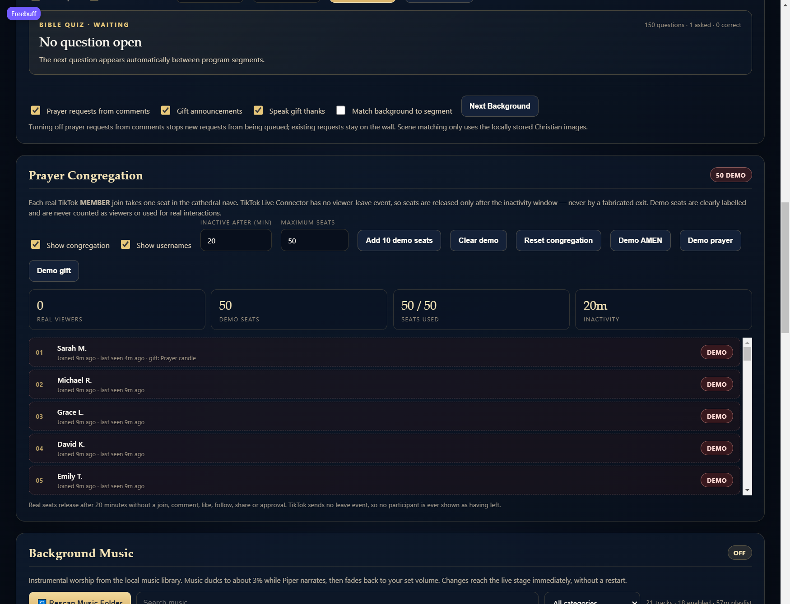

# ✝ CHRISTIAN PRAYER LIVE

**FAITH • HOPE • LOVE**

> *"Pray Together. Grow in Faith."*

A peaceful, interactive **9:16 vertical livestream prayer room** for TikTok Live, built for viewers in the United States. The project keeps the original Bun.js + JSON-RPC 2.0 + WebSocket + OBS architecture and the working Windows/Piper installation, while replacing the Buddhist temple experience with a general Christian prayer community.

The room is intentionally **general Christian** — welcoming to viewers across traditions. It focuses on Jesus Christ, prayer, hope, love, forgiveness, gratitude, grace, Scripture-inspired encouragement and peace.



---

## What is included

| Area | Implementation |
| --- | --- |
| Brand | Christian Prayer Live, deep navy / warm gold / ivory palette |
| Layout | 1080×1920 (9:16), auto-scaled for OBS browser source and desktop preview |
| Live connection | TikTok Live Connector: comments, likes, follows, shares, gifts |
| API | JSON-RPC 2.0 over HTTP (`/rpc`) and WebSocket (`/ws`) |
| Narration | Local Piper worker, American English + Vietnamese voices |
| Music | 21-track instrumental library (3 original CC0 + 18 licensed Mixkit tracks), admin rescan, crossfaded playlist, auto-ducking under narration |
| Live show | Automated welcome, Scripture, prayer, community and gratitude program with Piper narration |
| Prayer requests | Moderated queue with approve / hide / remove / pause / clear |
| Prayer congregation | 50-seat cathedral nave fed by real TikTok `MEMBER` joins; session-only, inactivity expiry, labelled demo preview |
| Backgrounds | 21 locally served licensed photographs + automatic fade rotation |
| Default scene | Licensed Gothic cathedral Mass with altar crucifix and praying congregation |
| Admin | English dashboard for connection, prayer queue, voices, backgrounds, messages |
| Compatibility | Original `temple.*` RPC methods and OBS URL preserved |

### Stage

- Full-frame cathedral scene: high Gothic arches, stained glass, altar crucifix and a gathered congregation.
- Warm golden grade, soft light aura, drifting particles and a gentle vignette.
- No floating hero cross and no baked-in text; the photograph itself is the main subject.
- Compact prayer request and “Verse of the Moment” cards above the lower panels.
- **Live Comments** beside a rotating **Prayer Wall** and community activity list.
- Centered program card for the current welcome, Scripture, prayer or community cue.
- Counter strip for prayers, candles, amens, followers and gifts.
- Event overlays: AMEN, prayer invitation, gratitude, welcome and tiered gift celebrations.
- Optional quick-controls dock on desktop; `?obs=1` hides it for a clean broadcast.
- **Prayer congregation** overlay above the lower panels: up to 50 seated viewers in scaled rows facing the altar, with a participant counter, AMEN glow, prayer symbol and gift celebration.
- Small on-stream photo credit for CC BY / CC BY-SA backgrounds.



---

## Windows quick start

The project is designed for the existing XAMPP-style Windows folder and the local `.venv`.

```bat
cd /d "C:\xampp\htdocs\ai\fbpage\banhang\tiktok y tuong marketing\1"

REM 1. JavaScript dependencies (only if node_modules is missing)
bun install

REM 2. Python environment (only if .venv is missing)
uv venv .venv
uv pip install --python .venv\Scripts\python.exe piper-tts pillow

REM 3. Start the app
bun run start
```

Open:

- **Livestream stage:** <http://localhost:3000>
- **OBS browser source:** <http://localhost:3000/?obs=1>
- **Admin dashboard:** <http://localhost:3000/admin>
- **Health check:** <http://localhost:3000/api/health>

The Piper worker is started automatically. The voice models are already installed under `config/piper/en` and `config/piper/vn`; the app does not download models.

> If `bun` is not on the PATH in Command Prompt, run `bun run start` from the Bun shell or add Bun to PATH. On this machine the app was started and tested with Bun 1.4 on Windows.

### OBS setup

1. Add a **Browser** source.
2. URL: `http://localhost:3000/?obs=1`
3. Width `1080`, Height `1920`.
4. Enable **Shutdown source when not visible** only if you also reload it when going live (the page reconnects automatically).
5. Use **Interact** once and press **Enable Audio** if OBS blocks autoplay. This unlocks the worship playlist, chimes and narration for the scene. OBS browser sources normally allow autoplay, so music starts with the source.
6. Keep the admin dashboard in a second browser window, not inside the OBS source.

---

## Connecting TikTok Live

1. Open `/admin`.
2. Enter the TikTok `@username` or a `https://www.tiktok.com/@username/live` link.
3. Press **Connect Live** while the account is actually live.
4. The header badge changes to **CONNECTED** and the room ID / viewer count appear.
5. Press **Disconnect** when the broadcast ends.

Auto-connect only happens when `TIKTOK_USER` (or `tiktok.username` in `config/app.config.json`) is set. It is empty by default so the app never connects to the old Buddhist channel.

No TikTok credentials or cookies are required for public LIVE rooms. A real LIVE session is required to test the event handlers end to end.

---

## Viewer interactions

| Event | On-screen behavior |
| --- | --- |
| Comment `AMEN` | Gold AMEN overlay + soft chime |
| `PRAY` | “Let us pray together.” invitation |
| `JESUS` | Jesus-centered encouragement |
| `FAITH` / `HOPE` / `LOVE` | Short encouragement in that theme |
| `PRAYER` | Invites the viewer to send a prayer request |
| `GOD` | Short inspirational message |
| `THANK YOU` | Gratitude animation and message |
| `PRAY FOR ME`, `PRAYER REQUEST`, `PLEASE PRAY`, `PRAY FOR MY FAMILY` | Creates a moderated prayer request |
| Like | Subtle golden particles over the altar, AMEN counter |
| Follow | “Welcome to our prayer community. God bless you!” |
| Share | “Thank you for sharing faith, hope and love!” |
| Small gift | Gift spotlight with sender, gift name, quantity and a spoken thank-you |
| Medium gift | Spotlight plus warm golden-light and candlelight effects |
| Large gift | Spotlight plus a golden light celebration and community gratitude |
| Bible quiz | A KJV question stays on screen; correct comments are acknowledged by name before the reveal |

Messages are selected from `config/messages.en.json`; the four most recently used messages in a category are avoided, and command replies are rate limited so narration never turns into spam.

Gifts are **never** presented as purchasing prayers, blessings, healing or salvation. Prayer is always free. Gift cards only ever show a real event payload (sender, gift, quantity); nothing is fabricated for the stage.

---

## Prayer request moderation

Viewer comments that ask for prayer are cleaned before display:

- Links, email addresses, long digit strings and HTML are removed.
- Profanity and blocked words are filtered.
- Requests are limited to 120 characters by default.
- Each TikTok viewer has a 30-second cooldown.
- Only the first name is shown on the broadcast; the full display name stays in the admin queue.

Admin actions:

- **Approve** a pending request.
- **Hide** it from the broadcast without deleting it.
- **Remove** it permanently.
- **Pause notifications** during a sensitive moment.
- **Clear queue** at the end of a session.
- Turn **auto-approve** on or off (on by default for a smooth live flow).

The pastor/host should still review requests and avoid repeating sensitive details. The app never promises healing, wealth, miracles or supernatural outcomes.

---

## Narration (Piper)

The original `tts_worker.py` was replaced with a language-aware Piper worker. It keeps the long-running process + newline-delimited JSON protocol used by the server.

| Language | Default voice | Other installed voices |
| --- | --- | --- |
| English (en-US) | `en_US-amy-medium` | `en_US-arctic-medium`, `en_US-hfc_female-medium` |
| Vietnamese (vi-VN) | `vi_VN-vais1000-medium` | 13 more Vietnamese voices in `config/piper/vn` |

- English events request `lang: "en"` and always use a US English voice.
- Vietnamese requests use `lang: "vi"`; text passed without a language is auto-detected.
- Models are loaded on demand and cached in the worker (LRU-style, two models kept warm).
- Generated WAV files are cached in `data/tts-cache` by text + voice + rate.
- The browser keeps a single narration queue: speech never overlaps, background music ducks under speech, and repeated identical lines are suppressed for a short window.
- TTS can be disabled in the admin dashboard or with `TTS_ENABLED=false`.
- **Test English** and **Test Vietnamese** buttons in `/admin` exercise the real worker and play the result.

Piper is the active engine because the Windows checkout already contains the ONNX voice models. ZeroTTS was the previous engine, but this environment has no `zerotts` package and the old worker's local model path pointed to a macOS directory, so there was no working fallback to keep. The original worker remains in `backup/tts_worker.py.bak`.

---

## Ambient worship music

The livestream has a continuous, low-volume instrumental bed: soft piano, warm pads, gentle strings and cathedral-style ambience. The library holds **21 tracks** — 3 original CC0 compositions and 18 licensed Mixkit instrumentals — stored locally in `public/assets/christian/audio/`.

| Category | Tracks | Notes |
| --- | --- | --- |
| Ambient | 11 | Pads, meditation beds and the original Peaceful Prayer |
| Piano | 7 | Solo piano, reflective and morning themes |
| Cinematic | 3 | Flowing, hopeful atmospheric beds |

Every entry records its title, artist, duration, format, source URL, license and attribution in [music-manifest.json](public/assets/christian/audio/music-manifest.json). The full source/license table is in [docs/music-sources.md](docs/music-sources.md). The two rejected tracks (Quiet Hour, Cathedral Light) were removed from the playlist, dashboard and generator, and their files moved to `docs/backups/music-removed/`.

How playback works:

- The original Ogg tracks are decoded and looped sample-accurately with the Web Audio API. Mixkit MP3 tracks use a 3.5-second crossfade into the next track; the next file is decoded in advance.
- **Ducking:** music runs at 10% by default; when Piper starts a sentence it glides to 3.5%, then fades back over roughly two seconds. A limiter on the music bus prevents clipping.
- Track changes, pause/resume, volume, shuffle and repeat are stored in server state and broadcast over the WebSocket, so the OBS source follows the dashboard immediately without a reload.
- WebSocket events (comments, prayers, gifts) never restart playback; the current deck keeps its position.
- If the selected file disappears or is disabled during a broadcast, the server selects the next enabled track and the stage crossfades to it; a failed decode also advances instead of leaving silence.
- Autoplay follows the browser policy: OBS browser sources start automatically, regular tabs wait for the **Enable Audio** button.

Admin controls (**Background Music** panel in `/admin`):

- **🔄 Rescan Music Folder** — rescans only `public/assets/christian/audio/`, reports tracks found/added/removed/updated, rewrites the manifest atomically and keeps the previous version as `music-manifest.backup.json`. The dashboard and OBS playlist refresh without a restart.
- Search by title, artist, file or category; filter by category.
- Per-track title editing (display only — the filename is untouched), duration, format, size, category and status.
- Preview play/pause per track with its own preview volume, enable/disable (kept in the manifest but excluded from playback), and remove (moves the file to `docs/backups/music-removed/`).
- Play / pause, previous, next, select any enabled track, master volume (default 10%), shuffle, repeat mode and **Test Audio**.
- Total track count, enabled count and total playlist duration.

Regenerate the original tracks (no internet required):

```bat
.venv\Scripts\python.exe scripts\generate_music.py
```

The generator uses only `numpy` plus `ffmpeg` (for Opus encoding), rewrites only its own three tracks and preserves the licensed Mixkit entries.

---

## Automated live show

The prayer room runs itself. A repeating program alternates short segments so the stream always has something gentle happening, and the host can override any part of it from the dashboard.

| # | Segment | Holds for |
| --- | --- | --- |
| 1 | Welcome and peaceful introduction | 2:00 |
| 2 | Bible verse | 2:30 |
| 3 | Prayer session | 3:00 |
| 4 | Bible verse | 2:30 |
| 5 | Prayer session | 3:30 |
| 6 | Community prayer + prayer wall request | 3:00 |
| 7 | Bible verse | 2:30 |
| 8 | Prayer session | 3:30 |
| 9 | Bible reflection | 3:00 |
| 10 | Bible verse | 2:30 |
| 11 | Prayer of gratitude | 3:00 |
| 12 | Prayer session | 3:30 |

The cycle is about 35 minutes and then repeats; the **Pace** control on the dashboard stretches or tightens every segment at once (Gentle 1.3×, Standard 1×, Frequent 0.75×). Every segment fades a card onto the stage for 15–17 seconds — the card stays up while Piper is still speaking — and narration is queued so two prayers never overlap. Music ducks underneath automatically and returns afterwards.

**Eight prayer themes, original prose:** Morning Prayer, Prayer for Healing, Prayer for Family, Prayer for Anxiety & Peace, Prayer for Financial Hardship, Prayer for Strength, Night Prayer, Prayer of Gratitude. Each theme has three prayers and the program avoids repeating a prayer or theme it used recently. The text never promises healing, wealth, miracles or salvation.

**Twenty verified KJV verses** with a short original reflection each. They live in `config/messages.en.json`, so the reflection can be edited in the dashboard's message library. Recent verses are remembered so the same reference does not return immediately.

**Welcome greetings.** When a real viewer joins the LIVE room (TikTok `MEMBER` event), the stage shows a welcome animation with their first name and Piper says a short greeting, for example: “Welcome, Sarah! We are so glad you are here. May God's peace be with you today.” A viewer is welcomed at most once every 45 minutes, greetings are spaced at least 20 seconds apart, and no more than three are sent in two minutes, so a busy room never turns into a greeting loop. Simulated events and the **Test Welcome** button never count as real viewers.

**Prayer wall.** Approved requests rotate in the stage's right column, first names only. The community segment may lift one request up in prayer; its text is shown on screen but narration uses only the first name, so personal details are never read aloud. Requests tagged as simulated stay off the wall and out of the program.

Admin controls (**Live Show Automation** panel in `/admin`):

- Enable or disable automation, pause or resume the program.
- Welcome-greeting toggle and a separate narration toggle for the program.
- Prayer theme: rotate all eight, or pin one theme.
- Pace: Gentle (1.3×), Standard (1×) or Frequent (0.75×) hold times.
- Next Segment, Next Bible Verse, Next Reflection, Next Prayer, Gratitude Prayer.
- Test Welcome (clearly labelled as a sample), Restart Program.
- Live program status, next segment countdown and a log of auto / manual / test cues.

The same controls exist in compact form in the stage's quick dock. Pausing stops the schedule but leaves manual cues available; welcome greetings keep their own switch.

---

## Bible quiz and community engagement

A Bible quiz runs between program segments: one verified KJV question at a time, answered in the TikTok comments.

- **150 original questions** in [lib/quiz.js](lib/quiz.js), each with a verified KJV reference, a short original explanation and alternate accepted spellings/numbers.
- Answers are matched case-insensitively and tolerate extra spaces, so `noah`, `NOAH` and ` Noah ` all count.
- A viewer's first correct answer is counted once; repeat answers from the same viewer are ignored.
- The answer, reference and explanation stay hidden until the reveal, which happens 15–30 seconds later (25 by default). The reveal also names up to three correct viewers and is narrated by Piper when quiz narration is on.
- The question rotates through the bank and avoids the recently used questions. A question is open for its answer window, then the answer stays on screen for about 14 seconds before the card leaves.
- If a prayer or program cue is speaking when the reveal happens, the quiz narration is skipped rather than talking over it.

**Prayer requests from comments.** `PRAY`, `PRAYER`, `AMEN` and phrases like `PRAY FOR ME`, `PLEASE PRAY` or `PRAY FOR MY FAMILY` trigger a short on-stage invitation to share a request. A genuine request goes through the existing moderation queue, appears on the prayer wall with a first name only, and the community is thanked on screen. The invitation is rate limited so it cannot spam a busy chat. Turning off **Prayer requests from comments** in the dashboard stops new requests from being queued; existing requests stay on the wall.

**Listen for real events only.** The stage reacts to actual `temple.event` / `prayer.request` payloads from the TikTok connector. The dashboard's demo controls are labelled and the stage shows a red DEMO MODE badge whenever simulated activity is on.

**Scene matching.** When it is enabled, each program cue picks a locally stored image category that fits it: welcome → cathedral, Scripture/reflection → Bible, community → church, gratitude → Bible, and prayers by theme (healing/night → candles, family/finances → church, strength → cross, morning/anxiety → backgrounds). Background rotation stays inside that category until the next cue. Turn it off to keep the rotation fully manual.

Admin controls (**Community Engagement** panel in `/admin`): quiz on/off, answer narration, frequency (2–120 minutes), reveal delay, Next Question, Reveal Answer, prayer interaction toggle, gift announcement toggle, gift narration toggle, scene matching toggle and Next Background.

---

## Prayer congregation

Every real TikTok **MEMBER** join takes one seat in the cathedral nave. This is the original temple-congregation idea rebuilt for a general Christian audience: no statues, rituals, robes or Buddhist symbols, and no text baked into any image.

**Real joins only.** `WebcastEvent.MEMBER` is the only join source. Each TikTok `uniqueId` owns exactly one seat, so duplicate/replayed `MEMBER` frames update the existing participant instead of creating a second one. The seat is assigned from the first free position and arrives with a short kneeling animation; repeated joins do not re-animate or re-greet the viewer.

**There is no leave event.** TikTok Live Connector 2.5.0 exposes `MEMBER` with `MemberMessageAction.JOINED` / `SUBSCRIBED` but no viewer-left message, so the app never claims that someone left. A real seat is released only after the configured inactivity window (20 minutes by default), and the UI simply stops showing it. Comments, likes, follows, shares, joins, approved prayer requests and gifts refresh the last-seen time. An explicit **Disconnect** or a TikTok `STREAM_END` clears the session.

**Interactions.** These are driven by the real event pipeline, never by the logo or a timer:

| Event | Stage reaction |
| --- | --- |
| Real AMEN comment | short golden glow around that viewer's seat |
| Approved prayer request | small ✝ above the viewer's seat for two minutes |
| Real gift | warm golden burst around the sender's seat, tier animation continues elsewhere on stage |
| Like / follow / share / comment | quietly refreshes presence, so an active viewer is not expired |

**Layout.** One reusable inline SVG figure per seat, varied deterministically by a hash of the participant id (six skin tones, eight muted robe palettes, six hair tones, occasional veil). No image is generated or downloaded per viewer and no remote asset is requested. Seats are laid out in 13 columns with row scaling from back to front; 50 seats fill four rows on the 1080×1920 stage, and the dashboard can raise capacity to 80 (seven rows). Names are optional, truncated and discreet, and the row order keeps the cross and altar visible above the congregation.

**Session-only.** Participants live in memory in `lib/congregation.js`; they are deliberately **not** written to `data/prayer-state.json`, and only `name`, a hashed display id, seat, source and timestamps are kept. Nothing survives a server restart.

**Demo preview.** Dashboard buttons add labelled demo seats, which are shown with a pink `DEMO` prefix and a `DEMO PREVIEW` badge. Demo seats never increment the real viewer count and simulated AMEN/prayer/gift events are rejected for real seats, so a rehearsal can never impersonate a viewer.

Admin controls (**Prayer Congregation** panel in `/admin`): show/hide congregation, show/hide usernames, inactivity minutes (1–180), maximum seats (10–80), Add 10 demo seats, Clear demo, Reset congregation, Demo AMEN, Demo prayer and Demo gift.





---

## Backgrounds and licensing

All broadcast images are served locally from `public/assets/christian/`. No remote image is requested during the stream.

```
public/assets/christian/
├── asset-manifest.json
├── cathedral/     2  cathedral Mass / sanctuary service with congregation (default)
├── backgrounds/   3  sunrise / golden sky
├── church/        4  church interiors and naves
├── cross/         4  illuminated altar crosses
├── bible/         2  open Bible and communion table
├── candles/       4  prayer candles
├── jesus/         2  classical Christian artwork (public domain)
└── overlays/      3  generated light rays, gold bokeh, vignette
```

**21 photographs + 3 generated overlays.** Sources are Wikimedia Commons; every file was checked against its machine-readable license before download. Each manifest entry records the original file page, download URL, license, license URL, author/attribution, original dimensions and the local file size.

The default scene is `cathedral/cathedral-01-cathedral-mass.jpg` — a public-domain U.S. Customs and Border Protection photograph of a cathedral Mass, centre-cropped to 1080×1920 and colour-graded. The alternate `cathedral-02-sanctuary-service.jpg` is CC BY-SA 4.0 by Daniel G Rego. Both were cropped and graded from the original photographs; the originals remain available at the source pages in the manifest.

License summary:

| License | Count |
| --- | --- |
| CC BY-SA 3.0 | 9 |
| CC BY-SA 4.0 | 6 |
| CC BY 2.0 | 1 |
| CC BY 3.0 | 1 |
| CC0 / public domain | 7 (including 3 generated overlays) |

CC BY and CC BY-SA require credit and a license reference. The stage shows a small credit line for the current background, and the dashboard shows the full credit. **Keep [`asset-manifest.json`](public/assets/christian/asset-manifest.json) with the project** and include the photographer credits in the video description when required. If you redistribute modified images, follow the share-alike terms of the specific license.

Regenerate the collection (requires internet):

```bat
.venv\Scripts\python.exe scripts\fetch_christian_assets.py
```

The script rejects licenses outside its allowlist, deduplicates by file hash and writes the manifest.

---

## Automatic background rotation

Defaults: enabled, 60 seconds, 1600 ms cross-fade, `cathedral` category, random order. The two cathedral scenes rotate with each other; other Christian categories remain available from the dashboard.

Admin controls:

- Enable / disable rotation.
- Choose a category (`cathedral`, `church`, `cross`, `bible`, `candles`, `jesus`, `backgrounds`, or all).
- Choose a specific image immediately.
- Set the interval (10–3600 seconds via config; 10–300 seconds in the quick dock).
- Toggle random order.
- Preview every local background in a thumbnail grid.
- **Next Image** jumps immediately.

Rotation runs on the server and broadcasts `stage.background`, so every connected stage and OBS source stays in sync. A dark overlay and text shadows keep prayer text readable over bright photography.

---

## Configuration

`config/app.config.json` is the main configuration. Environment variables override it (`.env` is loaded automatically by Bun; `.env.example` lists the supported keys).

| Variable | Meaning | Default |
| --- | --- | --- |
| `PORT` | HTTP/WebSocket port | `3000` |
| `TIKTOK_USER` | Channel to auto-connect | empty |
| `DEFAULT_LANGUAGE` | Default narration language | `en` |
| `DEFAULT_EN_VOICE` | English Piper voice id | `en_US-amy-medium` |
| `DEFAULT_VN_VOICE` | Vietnamese Piper voice id | `vi_VN-vais1000-medium` |
| `TTS_ENABLED` | Enable spoken narration | `true` |
| `TTS_VOLUME` / `TTS_RATE` | Default volume / speed | `0.95` / `1.0` |
| `CHRISTIAN_THEME` | Brand theme marker | `christian` |
| `BACKGROUND_ROTATION` | Auto-rotate backgrounds | `true` |
| `BACKGROUND_ROTATION_INTERVAL` | Seconds between backgrounds | `60` |
| `BACKGROUND_CATEGORY` | Initial category | `all` |
| `PRAYER_AUTO_APPROVE` | Publish new requests immediately | `true` |
| `MUSIC_ENABLED` | Enable the worship music bed | `true` |
| `MUSIC_VOLUME` | Music volume (0–1) | `0.1` |
| `MUSIC_DUCK_VOLUME` | Volume while Piper speaks | `0.035` |
| `MUSIC_TRACK` | Startup track id | `peaceful-prayer-01` |
| `MUSIC_AUTOPLAY` | Start music once audio is unlocked | `true` |
| `SHOW_ENABLED` | Start the automated program | `true` |
| `SHOW_WELCOME` | Welcome real viewers who join | `true` |
| `SHOW_NARRATION` | Narrate program cues with Piper | `true` |
| `SHOW_THEME` | Pin a prayer theme, or `auto` | `auto` |
| `SHOW_PACE` | Hold-time multiplier (0.5–1.5) | `1` |
| `QUIZ_ENABLED` | Run the Bible quiz between segments | `true` |
| `QUIZ_FREQUENCY_MINUTES` | Minutes between questions | `10` |
| `QUIZ_REVEAL_SECONDS` | Answer window before the reveal | `25` |
| `QUIZ_TTS` | Narrate the answer | `true` |
| `GIFT_ANNOUNCE` | Show gift cards and gift TTS | `true` |
| `GIFT_TTS` | Speak the personalized gift thank-you | `true` |
| `PRAYER_INTERACTION` | Accept prayer requests from comments | `true` |
| `SCENE_MATCH` | Match the background to the program segment | `true` |

Settings changed in the dashboard are persisted in `data/prayer-state.json` and take precedence for the current installation. The legacy `data/merit-state.json` is still read as a migration fallback.

---

## API compatibility

All original RPC method names still work. User-facing labels changed; endpoint names did not.

| Group | Methods |
| --- | --- |
| State | `temple.getState`, `state.get`, `church.getState`, `prayer.getState` |
| Legacy rituals | `temple.burnIncense`, `temple.strikeWoodenFish`, `temple.ringBell`, `temple.sendPrayer`, `temple.offerGift`, `temple.drawFortune`, `temple.grandCeremony` |
| Settings | `temple.updateSettings`, `temple.resetMerit` |
| Chat | `temple.comment` |
| Narration | `temple.speak`, `temple.ttsStatus`, `tts.status`, `tts.voices`, `tts.test` |
| Prayer | `prayer.list`, `prayer.add`, `prayer.approve`, `prayer.hide`, `prayer.remove`, `prayer.clear`, `prayer.setPaused`, `prayer.setAutoApprove` |
| Backgrounds | `stage.listBackgrounds`, `stage.setBackground`, `stage.nextBackground`, `stage.updateBackgroundSettings` |
| Music | `music.get`, `music.update`, `music.next`, `music.previous`, `music.toggle`, `music.rescan`, `music.track.update`, `music.track.remove` |
| Messages | `messages.get`, `messages.save` |
| Live show | `show.status`, `show.update`, `show.next`, `show.nextVerse`, `show.nextReflection`, `show.nextPrayer`, `show.testWelcome`, `show.restart` |
| Bible quiz | `quiz.status`, `quiz.update`, `quiz.next`, `quiz.reveal`, `quiz.answer` |
| Gifts | `gift.update` (announce / TTS toggles) |
| Prayer congregation | `congregation.get`, `congregation.update`, `congregation.reset`, `congregation.demo`, `congregation.demoClear`, `congregation.demoEvent` |
| TikTok | `live.connect`, `live.disconnect`, `live.status`, `live.setAutoSim` |
| Settings / health | `settings.get`, `settings.update`, `health.check` |

Internal ritual names (`burnIncense`, `strikeWoodenFish`, `drawFortune`) are retained only for wire compatibility. Every label, message and visual shown to viewers is Christian.

WebSocket notifications include `temple.state`, `temple.event`, `prayer.request`, `prayer.state`, `prayer.hide`, `live.chat`, `stage.background`, `music.state`, `music.library.updated`, `tts.play`, `tts.status`, `show.state`, `show.cue`, `quiz.state`, `quiz.start`, `quiz.correct`, `quiz.reveal`, `quiz.end`, `congregation.state` and `temple.viewerCount`. A stage that connects mid-segment receives a replay of the cue that is still on screen.

Legacy state fields (`totalIncense`, `woodenFishHits`, `fortuneCount`, `offerings.lotus`, …) are still present alongside the new Christian counters.

---

## Project structure

```
server.js                  Bun/Express HTTP + WebSocket + TikTok + RPC + rotation
tts_worker.py              Piper multilingual worker (stdin/stdout JSON lines)
config/
  app.config.json          Brand, TTS, backgrounds, moderation, gift tiers
  messages.en.json         Editable English message library + verified verses
  piper/en|vn/             Installed Piper voices (untouched)
lib/
  show.js                  Program schedule, prayer themes, cue builder, welcomes
  congregation.js          Session-only seats, interactions, inactivity expiry, demo preview
  music-library.js         Audio-folder scanner, manifest writes, enable/disable, removal
  messages.js              Non-repeating message selection
  voices.js                Voice discovery + defaults
public/
  index.html               Livestream stage
  admin.html               Ministry dashboard
  css/live.css, admin.css
  js/live.js               Stage state, overlays, comments, rotation
  js/audio.js              Music player + ducking, chimes, narration queue
  js/particles.js          Canvas light particles
  js/admin.js              Dashboard controls
  assets/christian/        Local imagery + manifest
  assets/christian/audio/  21 instrumental tracks + music manifest
data/
  prayer-state.json        Persisted state
  tts-cache/               Generated WAV narration (gitignored)
scripts/
  smoke-test.js            API / WebSocket / TTS smoke test
  fetch_christian_assets.py  Licensed image fetcher
  generate_music.py        Original ambient track renderer
backup/                    Pre-conversion copies of modified files
```

---

## Testing

Run against a live server:

```bat
node scripts\smoke-test.js
```

Last run on this machine: **129/129 checks passed**, including:

- Bun server startup, health endpoint and brand payload.
- `temple.getState` compatibility and new counters.
- Background catalog (21 images, all 7 categories including the new cathedral category), local asset serving, manual change.
- Music library (21 tracks: 3 original CC0 + 18 licensed Mixkit), 2–6 minutes each, license and source on every entry, default 10% volume with a 3.5% duck level, local serving and a track change without a server restart.
- Music rescan: a copied MP3 is detected and titled from its filename, marked with an unverified license, served for preview, disabled (leaving the playlist), re-enabled, given a custom title that survives a rescan, then removed through the API with its file moved to `docs/backups/music-removed/`. A second file deleted directly from disk disappears on the next rescan. Directory-traversal ids are rejected and the previous manifest backup exists.
- Live show: 12-segment program, 8 prayer themes, 20 KJV verses each with a reflection, labelled test welcomes that never count as real viewers, manual verse/prayer/reflection cues, pause/resume, configurable pace and a `show.cue` WebSocket broadcast.
- Bible quiz: 150 questions with KJV references, hidden answer before the reveal, case-insensitive matching (`  NOAH `), duplicate suppression, wrong answers ignored, reveal payload, answers rejected after the reveal, configurable frequency/reveal delay and a `quiz.start` WebSocket broadcast.
- Gift pipeline: sender/quantity captured, personalized thank-you without purchase language, announcement and TTS toggles, and silenced gifts keeping an empty TTS payload.
- Prayer interaction toggle (disabled comments do not queue) and scene matching (healing prayer → candles category), then both restored.
- Prayer congregation: 60 joins fill exactly 50 seats with 50 unique positions; a duplicate join keeps one seat; simulated AMEN cannot animate a real seat; an approved prayer marks the seat; demo seats stay out of real counts; inactivity releases a silent seat; capacity clamps to 10–80; settings persist; reset clears every seat; demo AMEN/prayer/gift update only demo seats; `congregation.state` is broadcast over WebSocket.
- Prayer text and cue bodies checked for promised outcomes (healing, wealth, miracles, salvation).
- Prayer queue add / display / first-name privacy / pause / hide / remove.
- AMEN and PRAY comment commands, prayer-request detection and sanitization.
- English Piper synthesis (`en_US-amy-medium`) and WAV serving.
- Vietnamese Piper synthesis (`vi_VN-vais1000-medium`).
- Narration cache hit.
- English/Vietnamese voice discovery (3 EN, 14 VI).
- Settings update, editable message library, tiered gift messages, Bible references.
- All static pages/assets.
- WebSocket JSON-RPC result plus `prayer.request`, `temple.event`, `temple.state` notifications.
- TikTok connector initialization and graceful failure for a non-live handle (`Failed to retrieve Room ID from all sources.`) without crashing; `live.disconnect` clears the stale channel/error state.
- Browser rendering at 1080×1920 in headless Chromium, cathedral scene, background rotation within the cathedral category, AMEN overlay, prayer card, live comments/community, photo credit, footer placement and the admin dashboard.
- Music playback in Chromium: autoplay after load, seamless Web Audio loop, gain 0.10 → 0.035 during Piper narration → 0.10 after it ended, live track switch from the dashboard, pause/resume, admin volume slider, and the dashboard test player.
- Dashboard music manager in Chromium: rescan status message, search (`piano` → 7 matches), category filter, per-track preview playing past 5 seconds (200 audio/mpeg), per-track volume, disable/enable reflected in the playlist select, and an inline title saved to the manifest. The stage crossfaded to a newly selected track and recovered to the next enabled track when that temporary file was removed.
- Music continued through AMEN/prayer WebSocket events with no restart (verified by comparing the audio deck start time).
- Automated show in Chromium: program line, cue card, prayer wall rotation (Grace/Sarah → Emily/David) with first names only, and a `show.cue` narration that ducked music to 0.035 and restored it to 0.10 without restarting the track.
- A simulated prayer request stayed off the prayer wall and out of the community cue; simulated events carried a `simulated` flag and no welcome was generated from them.
- Community engagement in Chromium at 1080×1920: quiz card (question open, countdown), revealed answer card with reference/explanation, gift spotlight above the prayer cards showing `Grace L. sent 3x Prayer candle`, prayer invitation banner on a PRAY comment, and no console errors. Captures: [quiz-stage-open.jpg](docs/screenshots/quiz-stage-open.jpg), [quiz-stage-answer.jpg](docs/screenshots/quiz-stage-answer.jpg), [gift-stage.jpg](docs/screenshots/gift-stage.jpg), [prayer-invite-stage.jpg](docs/screenshots/prayer-invite-stage.jpg).
- The dashboard **Community Engagement** panel: quiz on/off (verified through `quiz.status`), frequency and reveal delay applied, and the prayer interaction toggle blocking a test request. Capture: [admin-community-engagement.jpg](docs/screenshots/admin-community-engagement.jpg).
- The final 1080×1920 capture is [live-show-stage.png](docs/screenshots/live-show-stage.png); the dashboard panel is [admin-live-show.png](docs/screenshots/admin-live-show.png).
- Browser console had no JavaScript errors after a fresh OBS-mode reload or a dashboard reload.

Not tested here:

- A real TikTok LIVE room (no live account/session was available). Connector wiring, event names and payload extraction were reviewed, but comment/like/follow/share/gift events — including the new join welcome — were not observed from TikTok itself. Welcome deduplication and the greeting text were tested through `show.testWelcome` and the engine's unit-level checks only.
- OBS Studio capture, its audio routing/monitoring and CEF performance (the page was verified in Chromium at the OBS aspect ratio, not inside OBS). Music played in the browser tab, but the OBS-side mix was not monitored here.
- Mixkit tracks were chosen from the Ambient, Piano and Cinematic catalogue categories and are marked as instrumentals by their metadata; vocal absence was not machine-audited with a vocal detector.
- Long-duration livestream stability/CPU over several hours.

The app starts cleanly and does not require a TikTok connection to render the stage or serve the dashboard.

---

## Operational notes

- Port `3000` is shared by the stage, admin and WebSocket. Change `PORT` if it is already in use.
- `backup/` contains the pre-conversion versions of the modified files.
- TTS cache and generated WAV files can be cleared safely; they are recreated on demand.
- `data/prayer-state.json` is the live state. Delete it to reset counters and the demo prayer queue.
- Demo activity is off by default. The **Simulate viewers** switch on the dashboard generates sample events for layout testing only; those events are flagged as simulated, never trigger welcomes, and never appear on the prayer wall. While it is on, a red **DEMO MODE · SIMULATED ACTIVITY** badge is visible on the stage so a test can never be mistaken for a real broadcast.
- The automated program starts about 12 seconds after launch, once Piper is ready. Set `SHOW_ENABLED=false` to start with automation off.
- The stage reconnects its WebSocket automatically if the server restarts, and replays the current cue if it is still within its display window.
